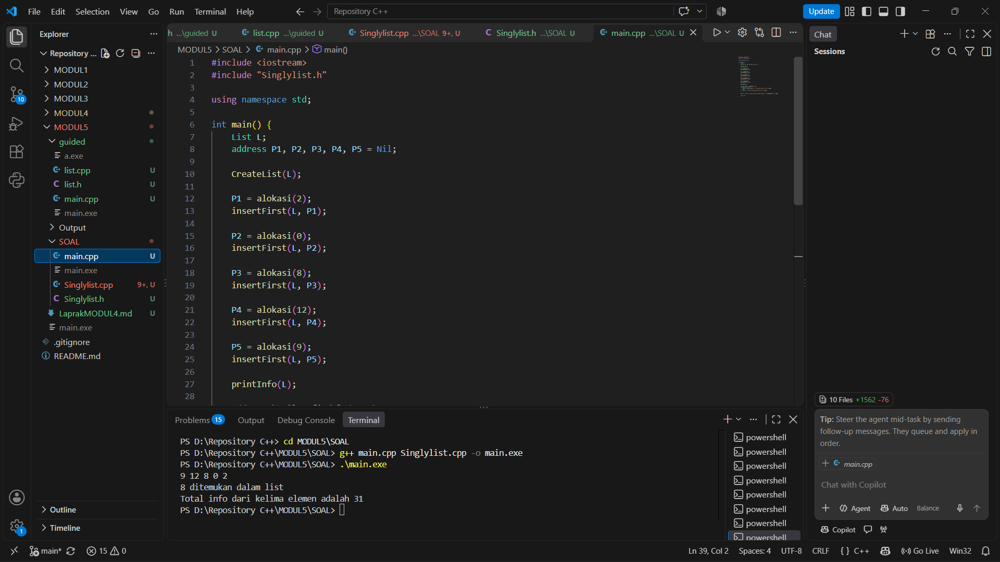

# <h1 align="center">Laporan Praktikum Modul 6 - Codeblocks IDE & Pengenalan Bahas C++ (Bagian Pertama)</h1>

<p align="center">  Sukma Aditya Rafindra - 109082500189</p>

## Dasar Teori

C++ merupakan bahasa pemrograman yang dikembangkan dari bahasa C dan digunakan untuk membuat berbagai jenis program. Dalam praktikum ini digunakan Code::Blocks sebagai IDE untuk menulis, melakukan compile, dan menjalankan program C++.

### A. Dasar Pemrograman C++

C++ memiliki beberapa komponen dasar seperti tipe data, variabel, konstanta, operator, input-output, dan fungsi.

#### 1. Tipe Data dan Variabel

Tipe data menentukan jenis data yang dapat disimpan, seperti `int` untuk bilangan bulat, `float` dan `double` untuk bilangan pecahan, serta `char` untuk karakter. Variabel digunakan untuk menyimpan nilai yang dapat berubah selama program berjalan.

#### 2. Input dan Output

Input digunakan untuk menerima data dari pengguna menggunakan `cin`, sedangkan output digunakan untuk menampilkan data menggunakan `cout`. Penggunaan input dan output merupakan bagian dasar dalam interaksi antara program dan pengguna.

#### 3. Operator

Operator digunakan untuk melakukan operasi pada data. C++ memiliki operator aritmatika seperti `+`, `-`, `*`, `/`, operator perbandingan seperti `==`, `!=`, `<`, `>`, serta operator logika seperti `&&`, `||`, dan `!`.

### B. Struktur Kendali Program

Struktur kendali digunakan untuk mengatur jalannya program berdasarkan kondisi atau pengulangan.

#### 1. Kondisional

Kondisional digunakan untuk mengambil keputusan berdasarkan suatu kondisi. C++ menyediakan `if`, `if-else`, dan `switch`.

#### 2. Perulangan

Perulangan digunakan untuk menjalankan perintah secara berulang. Jenis perulangan yang digunakan dalam C++ antara lain `for`, `while`, dan `do-while`.

#### 3. Struktur dan Fungsi

`struct` digunakan untuk menggabungkan beberapa data dengan tipe berbeda dalam satu kesatuan. Sementara itu, fungsi digunakan untuk membagi program menjadi bagian-bagian tertentu agar lebih terstruktur dan dapat digunakan kembali [1].

## Guided

### 1. listMakanan.h

```C++
#ifndef LISTMAKANAN_H
#define LISTMAKANAN_H
#define Nil NULL

#include <iostream>
using namespace std;

struct makanan
{
    string nama;
    string jenis;
    float harga;
    float rating;
};

typedef makanan dataMakanan;

typedef struct node *address;

struct node
{
    dataMakanan isidata;
    address next;
    address prev;
};

struct linkedlist
{
    address first;
    address last;
};

bool isEmpty(linkedlist List);
void createList(linkedlist &List);
address alokasi(string nama, string jenis, float harga, float rating);
void dealokasi(address &node);

void insertFirst(linkedlist &List, address nodeBaru);
void insertLast(linkedlist &List, address nodeBaru);
void insertAfter(linkedlist &List, address nodeBaru, address Prev);
void insertBefore(linkedlist &List, address nodeBaru, address nodeNext);

void printList(linkedlist List);

void updateFirst(linkedlist List);
void updateLast(linkedlist List);
void updateAfter(linkedlist List, address prev);
void updateBefore(linkedlist List, address nodeNext);

// Searching
void findByName(linkedlist List, string nama);
void findByJenis(linkedlist List, string jenis);
void findByMinRating(linkedlist List, float minRating);

// Delete
void deleteFirst(linkedlist &List);
void deleteLast(linkedlist &List);
void deleteAfter(linkedlist &List, address Prev);
void deleteBefore(linkedlist &List, address nodeNext);

void deleteNode(linkedlist &List, address target);
void deleteByName(linkedlist &List, string nama);

#endif
```

penjelasan singkat guided 1
Code tersebut merupakan file header `LISTMAKANAN.h` yang digunakan untuk mengatur data makanan menggunakan struktur Doubly Linked List. Di dalamnya terdapat struct `makanan` untuk menyimpan nama, jenis, harga, dan rating makanan. Setiap node memiliki pointer `next` dan `prev` agar data bisa terhubung ke depan maupun belakang. Struct `linkedlist` digunakan untuk menyimpan posisi data pertama (`first`) dan terakhir (`last`). Selain itu, terdapat deklarasi fungsi untuk mengecek list kosong, membuat list, menambah data, menampilkan data, mengubah data, mencari makanan berdasarkan nama, jenis, dan rating, serta menghapus data berdasarkan posisi maupun nama. Jadi, header ini berfungsi sebagai tempat deklarasi semua fungsi yang nantinya digunakan dalam program pengelolaan data makanan.


### 2. listMakanan.cpp

```C++
#include "listMakanan.h"
#include <iostream>
#include <string>
using namespace std;

bool isEmpty(linkedlist List)
{
    if (List.first == Nil)
    {
        return true;
    }
    else
    {
        return false;
    }
}

void createList(linkedlist &List)
{
    List.first = Nil;
    List.last = Nil;
}

// pembuatan node baru dengan menerapkan manajemen memori
address alokasi(string nama, string jenis, float harga, float rating)
{
    address nodeBaru = new node;
    nodeBaru->isidata.nama = nama;
    nodeBaru->isidata.jenis = jenis;
    nodeBaru->isidata.harga = harga;
    nodeBaru->isidata.rating = rating;
    nodeBaru->next = Nil;
    nodeBaru->prev = Nil;
    return nodeBaru;
}

void dealokasi(address &node)
{
    node->next = Nil;
    node->prev = Nil;
    delete node;
}

void insertFirst(linkedlist &List, address nodeBaru)
{
    if (isEmpty(List))
    {
        List.first = List.last = nodeBaru;
    }
    else
    {
        nodeBaru->next = List.first;
        List.first->prev = nodeBaru;
        List.first = nodeBaru;
    }
    cout << "Node " << nodeBaru->isidata.nama << " berhasil ditambahkan sebagai node pertama list" << endl;
}

void insertLast(linkedlist &List, address nodeBaru)
{
    if (isEmpty(List) == true)
    {
        List.first = List.last = nodeBaru;
    }
    else
    {
        nodeBaru->prev = List.last;
        List.last->next = nodeBaru;
        List.last = nodeBaru;
    }
    cout << "Node " << nodeBaru->isidata.nama << " berhasil ditambahkan sebagai node terakhir list" << endl;
}

void insertAfter(linkedlist &List, address nodeBaru, address nodePrev)
{
    if (isEmpty(List) == true)
    {
        List.first = List.last = nodeBaru;
    }
    else
    {
        if (nodePrev != Nil)
        {
            if (nodePrev == List.last)
            {
                insertLast(List, nodeBaru);
            }
            else
            {
                nodeBaru->next = nodePrev->next;
                nodeBaru->prev = nodePrev;
                (nodePrev->next)->prev = nodeBaru;
                nodePrev->next = nodeBaru;
                cout << "Node " << nodeBaru->isidata.nama << " berhasil ditambahkan setelah node " << nodePrev->isidata.nama << endl;
            }
        }
        else
        {
            cout << "node sebelumnya (nodePrev) tidak valid!" << endl;
        }
    }
}

void insertBefore(linkedlist &List, address nodeBaru, address nodeNext)
{
    if (isEmpty(List) == true)
    {
        List.first = List.last = nodeBaru;
    }
    else
    {
        if (nodeNext != Nil)
        {
            if (nodeNext == List.first)
            {
                insertFirst(List, nodeBaru);
            }
            else
            {
                nodeBaru->next = nodeNext;
                nodeBaru->prev = nodeNext->prev;
                (nodeNext->prev)->next = nodeBaru;
                nodeNext->prev = nodeBaru;
                cout << "Node " << nodeBaru->isidata.nama << " berhasil ditambahkan sebelum node " << nodeNext->isidata.nama << endl;
            }
        }
        else
        {
            cout << "node setelahnya (nodeNext) tidak valid!" << endl;
        }
    }
}

void printList(linkedlist List)
{
    if (isEmpty(List) == true)
    {
        cout << "List kosong!" << endl;
    }
    else
    {
        address nodeBantu = List.first;
        while (nodeBantu != Nil)
        {
            cout << "Nama makanan : " << nodeBantu->isidata.nama << endl;
            cout << "Jenis        : " << nodeBantu->isidata.jenis << endl;
            cout << "Harga        : " << nodeBantu->isidata.harga << endl;
            cout << "Rating       : " << nodeBantu->isidata.rating << endl;
            cout << "-------------------------------" << endl;
            nodeBantu = nodeBantu->next;
        }
    }
}

void updateFirst(linkedlist List)
{
    if (isEmpty(List) == true)
    {
        cout << "List kosong!" << endl;
    }
    else
    {
        cout << "Masukkan update data node pertama : " << endl;
        cout << "Nama makanan : ";
        getline(cin, List.first->isidata.nama);
        cout << "Jenis makanan : ";
        getline(cin, List.first->isidata.jenis);
        cout << "Harga : ";
        cin >> List.first->isidata.harga;
        cout << "Rating : ";
        cin >> List.first->isidata.rating;
        cin.ignore(); // menghapus karakter newline (/n) dari input buffer
        cout << "Data Berhasil Diupdate!" << endl;
        cout << endl;
    }
}

void updateLast(linkedlist List)
{
    if (isEmpty(List) == true)
    {
        cout << "List kosong!" << endl;
    }
    else
    {
        cout << "Masukkan update data node terakhir : " << endl;
        cout << "Nama makanan : ";
        getline(cin, List.last->isidata.nama);
        cout << "Jenis makanan : ";
        getline(cin, List.last->isidata.jenis);
        cout << "Harga : ";
        cin >> List.last->isidata.harga;
        cout << "Rating : ";
        cin >> List.last->isidata.rating;
        cin.ignore(); // menghapus karakter newline (/n) dari input buffer
        cout << "Data Berhasil Diupdate!" << endl;
        cout << endl;
    }
}

void updateAfter(linkedlist List, address nodePrev)
{
    if (isEmpty(List) == true)
    {
        cout << "List kosong!" << endl;
    }
    else
    {
        if (nodePrev != Nil && nodePrev->next != Nil)
        {
            address nodeBantu = nodePrev->next;
            cout << "masukkan update data node setelah node " << nodePrev->isidata.nama << " : " << endl;
            cout << "Nama makanan : ";
            getline(cin, nodeBantu->isidata.nama);
            cout << "Jenis makanan : ";
            getline(cin, nodeBantu->isidata.jenis);
            cout << "Harga : ";
            cin >> nodeBantu->isidata.harga;
            cout << "Rating : ";
            cin >> nodeBantu->isidata.rating;
            cin.ignore(); // menghapus karakter newline (/n) dari input buffer
            cout << "Data Berhasil Diupdate!" << endl;
            cout << endl;
        }
        else
        {
            cout << "Node sebelumnya (nodePrev) tidak valid!" << endl;
        }
    }
}

void updateBefore(linkedlist List, address nodeNext)
{
    if (isEmpty(List) == true)
    {
        cout << "List kosong!" << endl;
    }
    else
    {
        if (nodeNext != Nil && nodeNext->prev != Nil)
        {
            address nodeBantu = nodeNext->prev;
            cout << "masukkan update data node sebelum node " << nodeNext->isidata.nama << " : " << endl;
            cout << "Nama makanan : ";
            getline(cin, nodeBantu->isidata.nama);
            cout << "Jenis makanan : ";
            getline(cin, nodeBantu->isidata.jenis);
            cout << "Harga : ";
            cin >> nodeBantu->isidata.harga;
            cout << "Rating : ";
            cin >> nodeBantu->isidata.rating;
            cin.ignore(); // menghapus karakter newline (/n) dari input buffer
            cout << "Data Berhasil Diupdate!" << endl;
            cout << endl;
        }
        else
        {
            cout << "Node sebelumnya (prev) tidak valid!" << endl;
        }
    }
}

// SEARCHING
void findByName(linkedlist List, string nama)
{
    if (isEmpty(List))
    {
        cout << "List kosong!" << endl;
        return;
    }
    address p = List.first;
    while (p != Nil)
    {
        if (p->isidata.nama == nama)
        {
            cout << "Ditemukan (berdasarkan nama):" << endl;
            cout << "Nama makanan : " << p->isidata.nama << endl;
            cout << "Jenis        : " << p->isidata.jenis << endl;
            cout << "Harga        : " << p->isidata.harga << endl;
            cout << "Rating       : " << p->isidata.rating << endl;
            return;
        }
        p = p->next;
    }
    cout << "Data dengan nama \"" << nama << "\" tidak ditemukan." << endl;
}

void findByJenis(linkedlist List, string jenis)
{
    if (isEmpty(List))
    {
        cout << "List kosong!" << endl;
        return;
    }
    address p = List.first;
    while (p != Nil)
    {
        if (p->isidata.jenis == jenis)
        {
            cout << "Ditemukan (berdasarkan jenis):" << endl;
            cout << "Nama makanan : " << p->isidata.nama << endl;
            cout << "Jenis        : " << p->isidata.jenis << endl;
            cout << "Harga        : " << p->isidata.harga << endl;
            cout << "Rating       : " << p->isidata.rating << endl;
            return;
        }
        p = p->next;
    }
    cout << "Data dengan jenis \"" << jenis << "\" tidak ditemukan." << endl;
}

void findByMinRating(linkedlist List, float minRating)
{
    if (isEmpty(List))
    {
        cout << "List kosong!" << endl;
        return;
    }
    address p = List.first;
    while (p != Nil)
    {
        if (p->isidata.rating >= minRating)
        {
            cout << "Ditemukan (rating >= " << minRating << "):" << endl;
            cout << "Nama makanan : " << p->isidata.nama << endl;
            cout << "Jenis        : " << p->isidata.jenis << endl;
            cout << "Harga        : " << p->isidata.harga << endl;
            cout << "Rating       : " << p->isidata.rating << endl;
            return;
        }
        p = p->next;
    }
    cout << "Tidak ada data dengan rating >= " << minRating << "." << endl;
}

// DELETE
void deleteFirst(linkedlist &List)
{
    if (isEmpty(List) == true)
    {
        cout << "List kosong! Tidak ada node yang dihapus." << endl;
        return;
    }
    address pDel = List.first;
    if (List.first == List.last)
    {
        List.first = List.last = Nil;
    }
    else
    {
        List.first = pDel->next;
        List.first->prev = Nil;
        pDel->next = Nil;
    }
    cout << "Node " << pDel->isidata.nama << " berhasil dihapus dari posisi pertama." << endl;
    dealokasi(pDel);
}

void deleteLast(linkedlist &List)
{
    if (isEmpty(List) == true)
    {
        cout << "List kosong! Tidak ada node yang dihapus." << endl;
        return;
    }
    address pDel = List.last;
    if (List.first == List.last)
    {
        List.first = List.last = Nil;
    }
    else
    {
        List.last = pDel->prev;
        List.last->next = Nil;
        pDel->prev = Nil;
    }
    pDel->next = Nil;
    cout << "Node " << pDel->isidata.nama << " berhasil dihapus dari posisi terakhir." << endl;
    dealokasi(pDel);
}

void deleteAfter(linkedlist &List, address Prev)
{
    if (isEmpty(List) == true)
    {
        cout << "List kosong! Tidak ada node yang dihapus." << endl;
        return;
    }
    if (Prev == Nil || Prev->next == Nil)
    {
        cout << "Node sebelumnya (Prev) tidak valid atau tidak ada node setelahnya!" << endl;
        return;
    }
    if (Prev->next == List.last)
    {
        deleteLast(List);
        return;
    }
    address pDel = Prev->next;
    Prev->next = pDel->next;
    pDel->next->prev = Prev;
    pDel->next = Nil;
    pDel->prev = Nil;
    cout << "Node " << pDel->isidata.nama << " berhasil dihapus setelah node " << Prev->isidata.nama << "." << endl;
    dealokasi(pDel);
}

void deleteBefore(linkedlist &List, address nodeNext)
{
    if (isEmpty(List) == true)
    {
        cout << "List kosong! Tidak ada node yang dihapus." << endl;
        return;
    }
    if (nodeNext == Nil || nodeNext->prev == Nil)
    {
        cout << "Node setelahnya (nodeNext) tidak valid atau tidak ada node sebelumnya!" << endl;
        return;
    }
    if (nodeNext->prev == List.first)
    {
        deleteFirst(List);
        return;
    }
    address pDel = nodeNext->prev;
    nodeNext->prev = pDel->prev;
    pDel->prev->next = nodeNext;
    pDel->next = Nil;
    pDel->prev = Nil;
    cout << "Node " << pDel->isidata.nama << " berhasil dihapus sebelum node " << nodeNext->isidata.nama << "." << endl;
    dealokasi(pDel);
}

void deleteNode(linkedlist &List, address target)
{
    if (isEmpty(List) == true || target == Nil)
    {
        cout << "Target tidak valid atau list kosong!" << endl;
        return;
    }
    if (target == List.first)
    {
        deleteFirst(List);
    }
    else if (target == List.last)
    {
        deleteLast(List);
    }
    else
    {
        address L = target->prev;
        address R = target->next;
        L->next = R;
        R->prev = L;
        target->next = Nil;
        target->prev = Nil;
        cout << "Node " << target->isidata.nama << " berhasil dihapus dari tengah list." << endl;
        dealokasi(target);
    }
}

void deleteByName(linkedlist &List, string nama)
{
    if (isEmpty(List))
    {
        cout << "List kosong! Tidak ada node yang dihapus." << endl;
        return;
    }

    address target = List.first;
    while (target != Nil && target->isidata.nama != nama)
    {
        target = target->next;
    }
    if (target == Nil)
    {
        cout << "Node dengan nama \"" << nama << "\" tidak ditemukan." << endl;
        return;
    }

    deleteNode(List, target);
    cout << "Node dengan nama \"" << nama << "\" telah dihapus dan didealokasi." << endl;
}
```

penjelasan singkat guided 2
Code ini berisi kumpulan fungsi untuk mengelola data makanan menggunakan Doubly Linked List, mulai dari menambah, menampilkan, dan mengubah data hingga mencari dan menghapus makanan. Semua fungsi dibuat agar data bisa dikelola dari node pertama, terakhir, maupun bagian tengah list.

### 3. Main.cpp

```C++
#include "listMakanan.h"
#include <iostream>

using namespace std;

int main()
{
    linkedlist List;
    address nodeA, nodeB, nodeC, nodeD, nodeE = Nil;
    createList(List);

    dataMakanan dtMakanan;

    nodeA = alokasi("Nasi Rames", "Makanan Berat", 10000, 8.5);
    nodeB = alokasi("Ayam Geprek", "Makanan Berat", 13000, 9.0);
    nodeC = alokasi("Risol Mayo", "Makanan Ringan", 3500, 8.8);
    nodeD = alokasi("Mie Ayam", "Makanan Berat", 15000, 9.9);
    nodeE = alokasi("Donat", "Makanan Ringan", 2000, 7.7);

    insertFirst(List, nodeD);
    insertLast(List, nodeE);
    insertAfter(List, nodeA, nodeD);
    insertBefore(List, nodeC, nodeE);
    insertLast(List, nodeB);
    cout << endl;

    cout << "--- Isi List Setelah Insert ---" << endl;
    printList(List);
    cout << endl;

    updateFirst(List);
    updateLast(List);
    updateBefore(List, nodeC);
    updateAfter(List, nodeA);

    cout << "--- Isi List Setelah Update ---" << endl;
    printList(List);

    cout << endl;

    findByName(List, "Nasgor");
    findByMinRating(List, 9.0);

    deleteByName(List, "Nasgor");
    deleteFirst(List);
    deleteBefore(List, nodeE);

    cout << endl
         << "--- Isi List Setelah Delete ---" << endl;
    printList(List);

    return 0;
}
```
penjelasan singkat guided 3
Code ini merupakan program utama untuk menjalankan pengelolaan data makanan menggunakan Doubly Linked List. Program membuat lima data makanan, kemudian memasukkannya ke dalam list dengan posisi berbeda. Setelah itu, program menampilkan data, melakukan perubahan data, mencari makanan berdasarkan nama dan rating, serta menghapus beberapa data. Di akhir program, data makanan ditampilkan kembali untuk melihat hasil perubahan dan penghapusan.


## Unguided

### 1. Doublylist.h

```C++
#ifndef DOUBLYLIST_H
#define DOUBLYLIST_H

#include <iostream>
#include <string>
using namespace std;

#define Nil NULL

struct kendaraan {
    string nopol;
    string warna;
    int thnBuat;
};
typedef kendaraan infotype;

typedef struct ElmList *address;

struct ElmList {
    infotype info;
    address next;
    address prev;
};

struct List {
    address First;
    address Last;
};

void CreateList(List &L);
address alokasi(infotype x);
void dealokasi(address &P);
void printInfo(List L);
void insertLast(List &L, address P);

address findElm(List L, infotype x);

void deleteFirst(List &L, address &P);
void deleteLast(List &L, address &P);
void deleteAfter(address Prec, address &P);

#endif
```

penjelasan unguided 1
Code ini merupakan file header untuk mengelola data kendaraan menggunakan Doubly Linked List. Data yang disimpan meliputi nomor polisi, warna, dan tahun pembuatan kendaraan. Di dalamnya terdapat fungsi untuk membuat list, menambah data, menampilkan data, mencari kendaraan, serta menghapus node dari list.

### 2. Doublylist.cpp

```C++
#include "Doublylist.h"

void CreateList(List &L) {
    L.First = Nil;
    L.Last = Nil;
}

address alokasi(infotype x) {
    address P = new ElmList;
    P->info = x;
    P->next = Nil;
    P->prev = Nil;
    return P;
}

void dealokasi(address &P) {
    delete P;
    P = Nil;
}


void printInfo(List L) {
    address P = L.Last;
    while (P != Nil) {
        cout << "no polisi : " << P->info.nopol << endl;
        cout << "warna     : " << P->info.warna << endl;
        cout << "tahun     : " << P->info.thnBuat << endl;
        P = P->prev;
    }
}

void insertLast(List &L, address P) {
    if (L.First == Nil) {        
        L.First = P;
        L.Last = P;
    } else {
        P->prev = L.Last;
        (L.Last)->next = P;
        L.Last = P;
    }
}


address findElm(List L, infotype x) {
    address P = L.First;
    while (P != Nil) {
        if (P->info.nopol == x.nopol) {
            return P;
        }
        P = P->next;
    }
    return Nil;
}

void deleteFirst(List &L, address &P) {
    P = L.First;
    if (P == Nil) return;
    if (L.First == L.Last) {     
        L.First = Nil;
        L.Last = Nil;
    } else {
        L.First = (L.First)->next;
        (L.First)->prev = Nil;
        P->next = Nil;
    }
}

void deleteLast(List &L, address &P) {
    P = L.Last;
    if (P == Nil) return;
    if (L.First == L.Last) {    
        L.First = Nil;
        L.Last = Nil;
    } else {
        L.Last = (L.Last)->prev;
        (L.Last)->next = Nil;
        P->prev = Nil;
    }
}

void deleteAfter(address Prec, address &P) {
    P = Prec->next;
    if (P == Nil) return;
    Prec->next = P->next;
    (P->next)->prev = Prec;
    P->prev = Nil;
    P->next = Nil;
}
```

penjelasan unguided 2
Code ini berisi fungsi untuk mengelola Doubly Linked List data kendaraan. Fungsinya meliputi membuat list, menambahkan kendaraan di bagian akhir, menampilkan data, mencari kendaraan berdasarkan nomor polisi, serta menghapus node dari bagian pertama, terakhir, atau setelah node tertentu.


### 3. main.cpp

```C++
#include "Doublylist.h"

int main() {
    List L;
    CreateList(L);

    for (int i = 0; i < 4; i++) {
        infotype x;
        cout << "masukkan nomor polisi: ";
        cin >> x.nopol;
        cout << "masukkan warna kendaraan: ";
        cin >> x.warna;
        cout << "masukkan tahun kendaraan: ";
        cin >> x.thnBuat;

        if (findElm(L, x) != Nil) {
            cout << "nomor polisi sudah terdaftar" << endl;
        } else {
            insertLast(L, alokasi(x));
        }
        cout << endl;
    }

    cout << "DATA LIST 1" << endl << endl;
    printInfo(L);
    cout << endl;

    infotype cari;
    cout << "Masukkan Nomor Polisi yang dicari : ";
    cin >> cari.nopol;
    address P = findElm(L, cari);
    if (P != Nil) {
        cout << endl;
        cout << "Nomor Polisi : " << P->info.nopol << endl;
        cout << "Warna        : " << P->info.warna << endl;
        cout << "Tahun        : " << P->info.thnBuat << endl;
    } else {
        cout << "Data tidak ditemukan." << endl;
    }
    cout << endl;

    infotype hapus;
    cout << "Masukkan Nomor Polisi yang akan dihapus : ";
    cin >> hapus.nopol;
    address Q = findElm(L, hapus);
    if (Q == Nil) {
        cout << "Data dengan nomor polisi " << hapus.nopol << " tidak ditemukan." << endl;
    } else {
        address del;
        if (Q == L.First) {
            deleteFirst(L, del);
        } else if (Q == L.Last) {
            deleteLast(L, del);
        } else {
            deleteAfter(Q->prev, del);
        }
        dealokasi(del);
        cout << "Data dengan nomor polisi " << hapus.nopol << " berhasil dihapus." << endl;
    }
    cout << endl << "DATA LIST 1" << endl << endl;
    printInfo(L);

    return 0;
}
```
### Output Unguided 3 :

##### Output 1



penjelasan unguided 3
Code ini merupakan program utama untuk mengelola data kendaraan menggunakan Doubly Linked List. Program meminta pengguna memasukkan empat data kendaraan, mengecek nomor polisi agar tidak duplikat, menampilkan data, mencari kendaraan berdasarkan nomor polisi, dan menghapus data kendaraan yang dipilih. Setelah data dihapus, program menampilkan kembali isi list untuk melihat hasilnya.


## Kesimpulan
Kesimpulan:

Dari seluruh program yang telah dibuat, dapat disimpulkan bahwa Doubly Linked List dapat digunakan untuk mengelola data dengan lebih mudah karena setiap node saling terhubung melalui pointer `next` dan `prev`. Melalui program ini, kita belajar cara menambahkan, menampilkan, mengubah, mencari, dan menghapus data. Penerapannya dapat digunakan untuk mengelola berbagai data, seperti makanan dan kendaraan. Dengan begitu, kita bisa memahami bagaimana Doubly Linked List bekerja dalam pengelolaan data secara terstruktur.


## Referensi
[1] Triase. (2020). Diktat Edisi Revisi: STRUKTUR DATA. Medan: Universitas Islam Negeri Sumatera Utara Medan.

<br>[2] Indahyati, Uce., Rahmawati Yunianita. (2020). "BUKU AJAR ALGORITMA DAN PEMROGRAMAN DALAM BAHASA C++". Sidoarjo: Umsida Press. Diakses pada 10 Maret 2024 melalui https://doi.org/10.21070/2020/978-623-6833-67-4.

<br>[3] Modul 6. (2024). "CODE BLOCKS IDE & PENGENALAN BAHASA C++ (BAGIAN PERTAMA)". Modul Praktikum.
