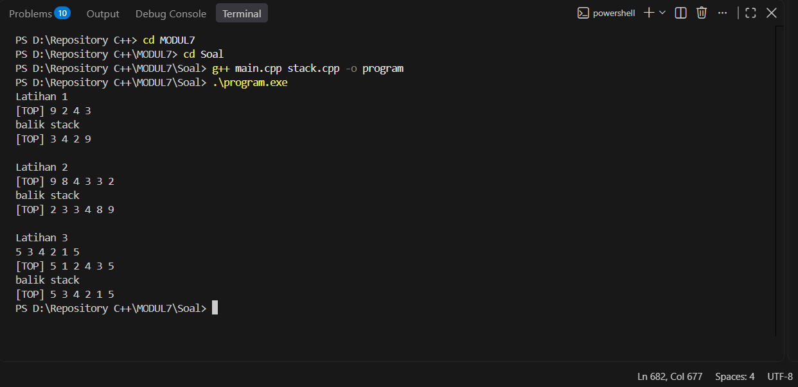
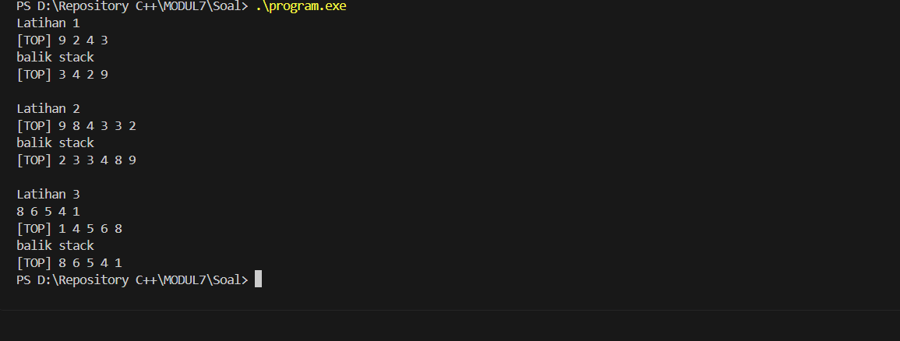

# <h1 align="center">Laporan Praktikum Modul 7 - Codeblocks IDE & Pengenalan Bahas C++ (Bagian Pertama)</h1>

<p align="center">  Sukma Aditya Rafindra - 109082500189</p>

## Dasar Teori

C++ merupakan bahasa pemrograman yang dikembangkan dari bahasa C dan digunakan untuk membuat berbagai jenis program. Dalam praktikum ini digunakan Code::Blocks sebagai IDE untuk menulis, melakukan compile, dan menjalankan program C++.

### A. Dasar Pemrograman C++

C++ memiliki beberapa komponen dasar seperti tipe data, variabel, konstanta, operator, input-output, dan fungsi.

#### 1. Tipe Data dan Variabel

Tipe data menentukan jenis data yang dapat disimpan, seperti `int` untuk bilangan bulat, `float` dan `double` untuk bilangan pecahan, serta `char` untuk karakter. Variabel digunakan untuk menyimpan nilai yang dapat berubah selama program berjalan.

#### 2. Input dan Output

Input digunakan untuk menerima data dari pengguna menggunakan `cin`, sedangkan output digunakan untuk menampilkan data menggunakan `cout`. Penggunaan input dan output merupakan bagian dasar dalam interaksi antara program dan pengguna.

#### 3. Operator

Operator digunakan untuk melakukan operasi pada data. C++ memiliki operator aritmatika seperti `+`, `-`, `*`, `/`, operator perbandingan seperti `==`, `!=`, `<`, `>`, serta operator logika seperti `&&`, `||`, dan `!`.

### B. Struktur Kendali Program

Struktur kendali digunakan untuk mengatur jalannya program berdasarkan kondisi atau pengulangan.

#### 1. Kondisional

Kondisional digunakan untuk mengambil keputusan berdasarkan suatu kondisi. C++ menyediakan `if`, `if-else`, dan `switch`.

#### 2. Perulangan

Perulangan digunakan untuk menjalankan perintah secara berulang. Jenis perulangan yang digunakan dalam C++ antara lain `for`, `while`, dan `do-while`.

#### 3. Struktur dan Fungsi

`struct` digunakan untuk menggabungkan beberapa data dengan tipe berbeda dalam satu kesatuan. Sementara itu, fungsi digunakan untuk membagi program menjadi bagian-bagian tertentu agar lebih terstruktur dan dapat digunakan kembali [1].

## Guided 1

### 1. stack.h

```C++
#ifndef STACK_TABLE
#define STACK_TABLE
#include <iostream>
using namespace std;
const int MAX = 10;

struct stackTable
{
    int data[MAX];
    int top;
};
bool isEmpty(stackTable s);
bool isFull(stackTable s);
void createStack(stackTable &s);
void push(stackTable &s, int angka);
void pop(stackTable &s);
void update(stackTable &s, int posisi);
void view(stackTable s);
void searchData(stackTable s, int data);
#endif
```

### 2. stack.cpp

```C++
#include "stack.h"
#include <iostream>
using namespace std;

bool isEmpty(stackTable s)
{
    return s.top == -1;
}
bool isFull(stackTable s)
{
    return s.top == MAX - 1;
}
void createStack(stackTable &s)
{
    s.top = -1;
}
void push(stackTable &s, int angka)
{

    if (isFull(s))
    {
        cout << "Stack penuh!" << endl;
    }
    else
    {
        s.top++;
        s.data[s.top] = angka;
        cout << "Data" << angka << "berhasil ditambahkan kedalam stack !" << endl;
    }
}

void pop(stackTable &s)
{
    if (isEmpty(s))
    {
        cout << "Stack kosong!" << endl;
    }
    else
    {
        int val = s.data[s.top];
        s.top--;
        cout << "Data" << val << " berhasil dihapus dari stack!" << endl;
    }
}

void update(stackTable &s, int posisi)
{
    if (isEmpty(s))
    {
        cout << "Stack kosong!" << endl;
    }
    if (posisi <= 0)
    {
        cout << "Posisi tidak valid!" << endl;
        return;
    }
    // index = top

      int idx = s.top - (posisi - 1);
      if (idx < 0 || idx > s.top)
      {
          cout << "Posisi " << posisi << " tidak valid!" << endl;
          return;
      }

      cout << "Update data posisi ke-" << posisi << endl;
      cout << "Masukkan angka : ";
      cin >> s.data[idx];
      cout << "Data berhasil diupdate!" << endl;
      cout << endl;
  }

  void view(stackTable s)
  {
      if (isEmpty(s))
      {
          cout << "Stack kosong!" << endl;
      }
      else
      {
          for (int i = s.top; i >= 0; --i)
          {
              cout << s.data[i] << " ";
          }
      }
      cout << endl;
  }

  void searchData(stackTable s, int data)
  {
      if (isEmpty(s))
      {
          cout << "Stack kosong!" << endl;
          return;


      cout << "Mencari data " << data << "..." << endl;
      int posisi = 1;
      bool found = false;

      for (int i = s.top; i >= 0; --i)
      {
          if (s.data[i] == data)
          {
              cout << "Data " << data << " ditemukan pada posisi ke-" << posisi << endl;
              cout << endl;
              found = true;
              break;
          }
          posisi++;
      }

      if (!found)
      {
          cout << "Data " << data << " tidak ditemukan didalam stack!" << endl;
          cout << endl;
      }
    }
}
```

### 3. Main.cpp

```C++
#include "stack.h"
#include <iostream>

using namespace std;

int main()
{
    stackTable s;
    createStack(s);

    push(s, 1);
    push(s, 2);
    push(s, 3);
    push(s, 4);
    push(s, 5);
    cout << endl;

    cout << "--- Stack setelah push ---" << endl;
    view(s);
    cout << endl;

    pop(s);
    pop(s);
    cout << endl;

    cout << "--- Stack setelah pop 2 kali ---" << endl;
    view(s);
    cout << endl;

    update(s, 2);
    update(s, 1);
    cout << endl;

    cout << "--- Stack setelah update ---" << endl;
    view(s);
    cout << endl;

    searchData(s, 4);
    searchData(s, 9);

    return 0;
}
```
penjelasan singkat guided 1
Program ini menyiapkan tumpukan berkapasitas sepuluh data, lalu mengisinya dengan angka satu sampai lima dan menghapus dua data paling atas. Setelah itu, pengguna diminta mengganti nilai pada dua urutan teratas secara interaktif, lalu program mencari letak angka empat dan sembilan di dalam tumpukan tersebut.


## Guided 2

### 1. stack.h

```C++
#ifndef STACK
#define STACK
#define Nil NULL

#include <iostream>
using namespace std;

typedef struct node *address;
struct node
{
    int dataAngka;
    address next;
};

struct stack
{
    address top;
};

bool isEmpty(stack listStack);
void createStack(stack &listStack);
address alokasi(int angka);
void dealokasi(address &node);

void push(stack &listStack, address nodeBaru);
void pop(stack &listStack);
void update(stack &listStack, int posisi);
void view(stack listStack);
void searchData(stack listStack, int data);
#endif
```

### 2. stack.cpp

```C++
#include "stack.h"
#include <iostream>

using namespace std;

bool isEmpty(stack listStack)
{
    if (listStack.top == Nil)
    {
        return true;
    }
    else
    {
        return false;
    }
}

void createStack(stack &listStack)
{
    listStack.top = Nil;
}

address alokasi(int angka)
{
    address nodeBaru = new node;
    nodeBaru->dataAngka = angka;
    nodeBaru->next = Nil;
    return nodeBaru;
}

void dealokasi(address &node)
{
    node->next = Nil;
    delete node;
}

void push(stack &listStack, address nodeBaru)
{
    nodeBaru->next = listStack.top;
    listStack.top = nodeBaru;
    cout << "Node " << nodeBaru->dataAngka << " berhasil ditambahkan kedalam stack!" << endl;
}

void pop(stack &listStack)
{
    address nodeHapus;
    if (isEmpty(listStack) == true)
    {
        cout << "Stack kosong!" << endl;
    }
    else
    {
        nodeHapus = listStack.top;
        listStack.top = listStack.top->next;
        nodeHapus->next = Nil;
        dealokasi(nodeHapus);
        cout << "node " << nodeHapus->dataAngka << " berhasil dihapus dari stack!" << endl;
    }
}

void update(stack &listStack, int posisi)
{
    if (isEmpty(listStack) == true)
    {
        cout << "Stack kosong!" << endl;
    }
    else
    {
        if (posisi == 0)
        {
            cout << "Posisi tidak valid!" << endl;
        }
        else
        {
            address nodeBantu = listStack.top;
            int count = 1;
            bool found = false;
            while (nodeBantu != Nil)
            {
                if (count < posisi)
                {
                    nodeBantu = nodeBantu->next;
                    count++;
                }
                else if (count == posisi)
                {
                    cout << "Update node poisisi ke-" << posisi << endl;
                    cout << "Masukkan angka : ";
                    cin >> nodeBantu->dataAngka;
                    cout << "Data berhasil diupdate!" << endl;
                    cout << endl;
                    found = true;
                    break;
                }
            }
            if (found == false)
            {
                cout << "Posisi " << posisi << " tidak valid!" << endl;
            }
        }
    }
}

void view(stack listStack)
{
    if (isEmpty(listStack) == true)
    {
        cout << "List kosong!" << endl;
    }
    else
    {
        address nodeBantu = listStack.top;
        while (nodeBantu != Nil)
        {
            cout << nodeBantu->dataAngka << " ";
            nodeBantu = nodeBantu->next;
        }
    }
    cout << endl;
}

void searchData(stack listStack, int data)
{
    if (isEmpty(listStack) == true)
    {
        cout << "List kosong!" << endl;
    }
    else
    {
        address nodeBantu = listStack.top;
        int posisi = 1;
        bool found = false;
        cout << "Mencari data " << data << "..." << endl;
        while (nodeBantu != Nil)
        {
            if (nodeBantu->dataAngka == data)
            {
                cout << "Data " << data << " ditemukan pada posisi ke-" << posisi << endl;
                found = true;
                cout << endl;
                break;
            }
            else
            {
                posisi++;
                nodeBantu = nodeBantu->next;
            }
        }
        if (found == false)
        {
            cout << "Data " << data << " tidak ditemukan didalam stack!" << endl;
            cout << endl;
        }
    }
}
```

### 3. Main.cpp

```C++
#include "stack.h"
#include <iostream>

using namespace std;

int main()
{
    stack listStack;
    address nodeA, nodeB, nodeC, nodeD, nodeE = Nil;
    createStack(listStack);

    nodeA = alokasi(1);
    nodeB = alokasi(2);
    nodeC = alokasi(3);
    nodeD = alokasi(4);
    nodeE = alokasi(5);

    push(listStack, nodeA);
    push(listStack, nodeB);
    push(listStack, nodeC);
    push(listStack, nodeD);
    push(listStack, nodeE);
    cout << endl;

    cout << "--- Stack setelah push ---" << endl;
    view(listStack);
    cout << endl;

    pop(listStack);
    pop(listStack);
    cout << endl;

    cout << "--- Stack setelah pop 2 kali ---" << endl;
    view(listStack);
    cout << endl;

    update(listStack, 2);
    update(listStack, 1);
    update(listStack, 4);
    cout << endl;

    cout << "--- Stack setelah update ---" << endl;
    view(listStack);
    cout << endl;

    searchData(listStack, 4);
    searchData(listStack, 9);

    return 0;
}
```
penjelasan singkat guided 2
program ini membangun tumpukan dinamis berbasis pointer yang diisi lima simpul berisi angka satu sampai lima, lalu menghapus dua simpul teratas sekaligus membebaskan memorinya. Selanjutnya, pengguna diminta mengganti nilai pada urutan kedua, pertama, dan keempat dari atas—meski posisi keempat akan dianggap tidak valid karena data tinggal tiga—lalu program menutup proses dengan mencari letak angka empat dan sembilan.


## Unguided

### 1. stack.h

```C++
#ifndef STACK_H
#define STACK_H

#include <iostream>

using namespace std;

typedef int infotype;

struct Stack {
    infotype info[20];
    int top;
};

void createStack(Stack &S);
bool isEmpty(Stack S);
bool isFull(Stack S);
void push(Stack &S, infotype x);
infotype pop(Stack &S);
void printInfo(Stack S);
void balikStack(Stack &S);
void pushAscending(Stack &S, infotype x);
void getInputStream(Stack &S);

#endif
```

### 2. stack.cpp

```C++
#include "stack.h"

void createStack(Stack &S) {
    S.top = -1;
}

bool isEmpty(Stack S) {
    return S.top == -1;
}

bool isFull(Stack S) {
    return S.top == 19;
}

void push(Stack &S, infotype x) {
    if (!isFull(S)) {
        S.top++;
        S.info[S.top] = x;
    }
}

infotype pop(Stack &S) {
    infotype x = -1;
    if (!isEmpty(S)) {
        x = S.info[S.top];
        S.top--;
    }
    return x;
}

void printInfo(Stack S) {
    cout << "[TOP] ";
    for (int i = S.top; i >= 0; i--) {
        cout << S.info[i] << " ";
    }
    cout << endl;
}

void balikStack(Stack &S) {
    if (!isEmpty(S)) {
        Stack temp1, temp2;
        createStack(temp1);
        createStack(temp2);

        while (!isEmpty(S)) {
            push(temp1, pop(S));
        }
        while (!isEmpty(temp1)) {
            push(temp2, pop(temp1));
        }
        while (!isEmpty(temp2)) {
            push(S, pop(temp2));
        }
    }
}

void pushAscending(Stack &S, infotype x) {
    Stack temp;
    createStack(temp);

    while (!isEmpty(S) && S.info[S.top] > x) {
        push(temp, pop(S));
    }

    push(S, x);

    while (!isEmpty(temp)) {
        push(S, pop(temp));
    }
}

void getInputStream(Stack &S) {
    char c;
    while (cin.get(c) && c != '\n') {
        if (c >= '0' && c <= '9') {
            push(S, c - '0');
        }
    }
}
```

### 3. main.cpp

```C++
#include <iostream>
#include "stack.h"

using namespace std;

int main() {
    Stack S;

    cout << "Latihan 1" << endl;
    createStack(S);
    push(S, 3);
    push(S, 4);
    push(S, 8);
    pop(S);
    push(S, 2);
    push(S, 3);
    pop(S);
    push(S, 9);
    printInfo(S);
    cout << "balik stack" << endl;
    balikStack(S);
    printInfo(S);
    cout << endl;

    cout << "Latihan 2" << endl;
    createStack(S);
    pushAscending(S, 3);
    pushAscending(S, 4);
    pushAscending(S, 8);
    pushAscending(S, 2);
    pushAscending(S, 3);
    pushAscending(S, 9);
    printInfo(S);
    cout << "balik stack" << endl;
    balikStack(S);
    printInfo(S);
    cout << endl;

    cout << "Latihan 3" << endl;
    createStack(S);
    getInputStream(S);
    printInfo(S);
    cout << "balik stack" << endl;
    balikStack(S);
    printInfo(S);

    return 0;
}
```
### Output Unguided :

##### Output 1




##### Output 2




penjelasan unguided 3
Program ini menguji tiga skenario tumpukan berbasis array secara berurutan. Pertama, program mendemonstrasikan cara menambah dan mengambil data paling atas, lalu membalik urutannya memakai tumpukan sementara. Kedua, data disisipkan agar otomatis tersusun urut, dan terakhir program membaca deretan angka ketikan pengguna hingga tombol enter ditekan untuk disimpan ke dalam tumpukan lalu dibalik kembali


## Kesimpulan
Kesimpulan:

Stack merupakan struktur data linear yang menerapkan prinsip Last In First Out (LIFO), di mana seluruh akses penambahan (push) maupun pengambilan data (pop) hanya berpusat pada satu titik paling atas yang disebut Top. Struktur tumpukan ini dapat dibangun menggunakan representasi tabel (array) yang memiliki kapasitas terbatas tanpa perlu manajemen memori, maupun representasi pointer yang bersifat dinamis melalui proses alokasi dan dealokasi simpul. Pemahaman terhadap mekanisme dasar ini memungkinkan pengembangan operasi lanjutan yang efektif, mulai dari pembalikan urutan tumpukan, penyisipan data secara terurut, pembaruan nilai, hingga pencarian posisi elemen tertentu.


## Referensi
[1] Triase. (2020). Diktat Edisi Revisi: STRUKTUR DATA. Medan: Universitas Islam Negeri Sumatera Utara Medan.

<br>[2] Indahyati, Uce., Rahmawati Yunianita. (2020). "BUKU AJAR ALGORITMA DAN PEMROGRAMAN DALAM BAHASA C++". Sidoarjo: Umsida Press. Diakses pada 10 Maret 2024 melalui https://doi.org/10.21070/2020/978-623-6833-67-4.

<br>[3] Modul 7. (2024). "CODE BLOCKS IDE & PENGENALAN BAHASA C++ (BAGIAN PERTAMA)". Modul Praktikum.
