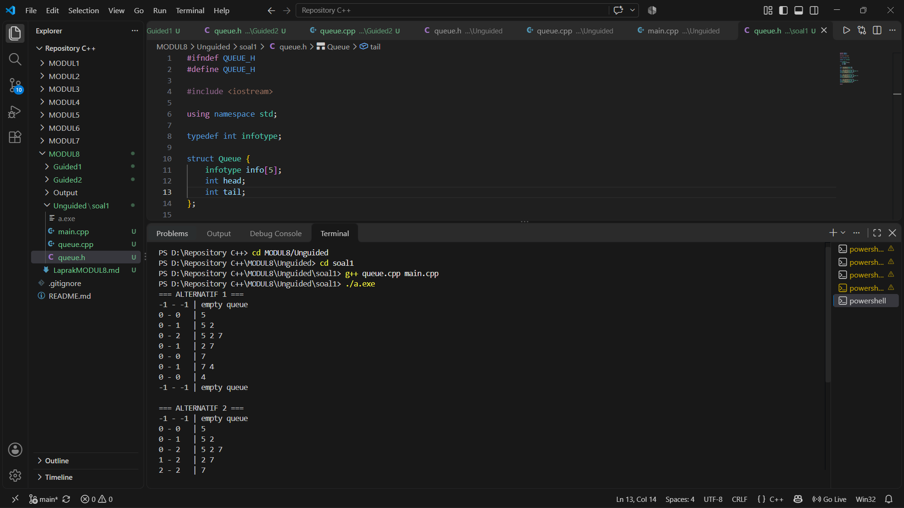
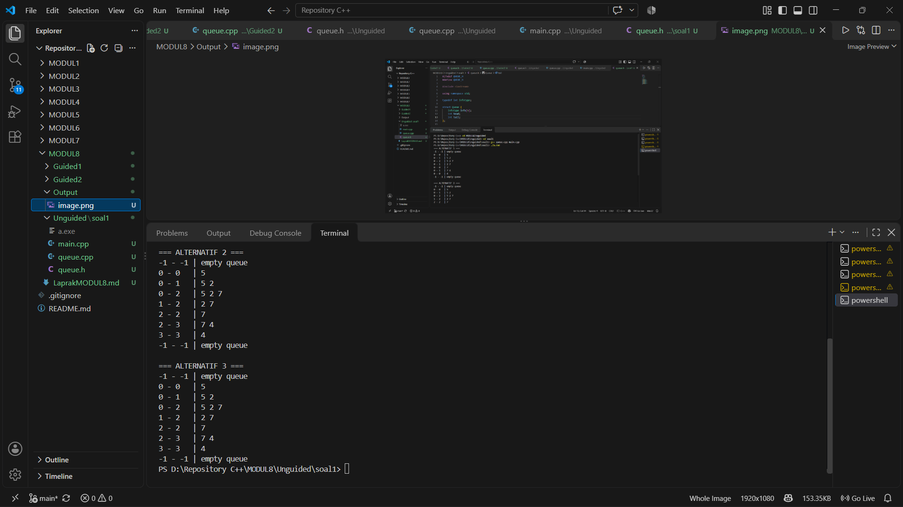

# <h1 align="center">Laporan Praktikum Modul 8 - Codeblocks IDE & Pengenalan Bahas C++ (Bagian Pertama)</h1>

<p align="center">  Sukma Aditya Rafindra - 109082500189</p>

## Dasar Teori

C++ merupakan bahasa pemrograman yang dikembangkan dari bahasa C dan digunakan untuk membuat berbagai jenis program. Dalam praktikum ini digunakan Code::Blocks sebagai IDE untuk menulis, melakukan compile, dan menjalankan program C++.

### A. Dasar Pemrograman C++

C++ memiliki beberapa komponen dasar seperti tipe data, variabel, konstanta, operator, input-output, dan fungsi.

#### 1. Tipe Data dan Variabel

Tipe data menentukan jenis data yang dapat disimpan, seperti `int` untuk bilangan bulat, `float` dan `double` untuk bilangan pecahan, serta `char` untuk karakter. Variabel digunakan untuk menyimpan nilai yang dapat berubah selama program berjalan.

#### 2. Input dan Output

Input digunakan untuk menerima data dari pengguna menggunakan `cin`, sedangkan output digunakan untuk menampilkan data menggunakan `cout`. Penggunaan input dan output merupakan bagian dasar dalam interaksi antara program dan pengguna.

#### 3. Operator

Operator digunakan untuk melakukan operasi pada data. C++ memiliki operator aritmatika seperti `+`, `-`, `*`, `/`, operator perbandingan seperti `==`, `!=`, `<`, `>`, serta operator logika seperti `&&`, `||`, dan `!`.

### B. Struktur Kendali Program

Struktur kendali digunakan untuk mengatur jalannya program berdasarkan kondisi atau pengulangan.

#### 1. Kondisional

Kondisional digunakan untuk mengambil keputusan berdasarkan suatu kondisi. C++ menyediakan `if`, `if-else`, dan `switch`.

#### 2. Perulangan

Perulangan digunakan untuk menjalankan perintah secara berulang. Jenis perulangan yang digunakan dalam C++ antara lain `for`, `while`, dan `do-while`.

#### 3. Struktur dan Fungsi

`struct` digunakan untuk menggabungkan beberapa data dengan tipe berbeda dalam satu kesatuan. Sementara itu, fungsi digunakan untuk membagi program menjadi bagian-bagian tertentu agar lebih terstruktur dan dapat digunakan kembali [1].

## Guided 1

### 1. queue.h

```C++
#ifndef QUEUE_H
#define QUEUE_H

#include <iostream>
#include <string>
using namespace std;

struct Node {
    string nama;
    Node *next;
};

struct queue {
    Node *head, *tail;
};

void CreateQueue(queue &Q);
bool isEmpty(queue Q);
bool isFull(queue Q);
void enQueue(queue &Q, const string &nama);
void deQueue(queue &Q);
void viewQueue(queue Q);
void clearQueue(queue &Q);
#endif
```

### 2. queue.cpp

```C++
#include "queue.h"

void CreateQueue(queue &Q) {
    Q.head = Q.tail = nullptr;
}

bool isEmpty(queue Q) {
    return Q.head == nullptr;
}

bool isFull(queue Q) {
    int maxQueue = 20;
    int counter = 0;
    Node *nodeBantu = Q.head;
    while (nodeBantu != Q.tail) {
        counter++;
        nodeBantu = nodeBantu->next;
    }
    return counter >= maxQueue;
}

void enQueue(queue &Q, const string &nama) {
    if (isEmpty(Q)) {
        Node *nodeBaru = new Node(nama, nullptr);
        Q.head = Q.tail = nodeBaru;
    } else {
        Node *nodeBaru = new Node(nama, nullptr);
        Q.tail->next = nodeBaru;
        Q.tail = nodeBaru;
    }
}

void deQueue(queue &Q) {
    if (isEmpty(Q)) {
        cout << "Queue kosong";
    } else {
        Node *nodeHapus = Q.head;
        Q.head = Q.head->next;
        delete nodeHapus;
    }
}

void viewQueue(queue Q) {
    if (isEmpty(Q)) {
        cout << "Queue kosong";
    } else {
        Node *nodeBantu = Q.head;
        while (nodeBantu != nullptr) {
            cout << "Nama : " << nodeBantu->nama;
            nodeBantu = nodeBantu->next;
        }
    }
}


void clearQueue(queue &Q) {
    if (!isEmpty(Q)) {
        cout << "Queue kosong";
    }else{
        Node *nodeHapus = Q.head;
        while (nodeHapus != nullptr) {
            nodeHapus = nodeHapus->next;
            deQueue(Q);
        }
    }
}
```

### 3. Main.cpp

```C++
#include "queue.h"
#include <iostream>
using namespace std;

int main() {
    queue Q;
    CreateQueue(Q);

    enQueue(Q, "Gilar");
    enQueue(Q, "Aflah");
    enQueue(Q, "Aedil");
    enQueue(Q, "Fathir");
    enQueue(Q, "Kevin");
    enQueue(Q, "Zulfa");
    cout << endl;

    cout << "--- Isi Queue Setelah enQueue ---" << endl;
    viewQueue(Q);

    clearQueue(Q);
    return 0;
}
```
penjelasan singkat guided 1
Program ini menggunakan struktur antrean dinamis berbasis pointer untuk menampung data nama. Selanjutnya, enam nama dimasukkan secara berurutan ke bagian belakang antrean. Program kemudian menampilkan seluruh nama mulai dari posisi paling depan dan diakhiri dengan menghapus semua data dalam antrean.


## Guided 2

### 1. queue.h

```C++
#ifndef QUEUE_H
#define QUEUE_H

#include <iostream>
using namespace std;

const int MAKSIMAL = 5;

struct queue{
    string nama[MAKSIMAL];
    int head;
    int tail;
};

bool isFull(queue Q);
bool isEmpty(queue Q);
void CreateQueue(queue &Q);
void enQueue(queue &Q, string nama);
void deQueue(queue &Q);
void viewQueue(queue Q);

#endif
```

### 2. queue.cpp

```C++
#include "queue_array.h"
#include <iostream>

using namespace std;

// NOTE : 
// Implementasi 1 = head diam, tail bergerak (Queue Linear Statis, kerana head nya tetap diam)
// Implementasi 2 = head bergerak, tail bergerak (Queue Linear Dinamis, karena head & tail nya sama-sama bergerak)
// Implementasi 3 = head dan tail berputar (Queue Circular, karena jika udh mentok tapi masih ada space, diputar sehingga tail bisa ada didepan head)

bool isEmpty(q q){
    return (q.head == -1 && q.tail == -1)
}

//isFull implmenetasi 1 & 2
bool isFull(Q q){
    return (q.tail == MAKSIMAL - 1)
}

// //isFull implementasi 3
// bool isFull(Q q){
//     return ((q.tail + 1) % MAKSIMAL == q.head)

void CreateQueue(Q &q){ //terbentuk queue dengan head = -1 dan tail = -1 
    q.head = -1;
    q.tail = -1;
}
 

//enqueue implementasi 1 & 2
void enQueue(Q &q, string nama){
    if(isFull(q) == true){
        cout << "Queue sudah penuh!" << endl;
    } else {
        if(isEmpty(q) == true){
            q.head = q.tail = 0;
        } else {
            q.tail++;
        }
        q.nama[q.tail] = nama;
        cout << "nama " << nama << " berhasil ditambahkan kedalam queue!" << endl;
    }
}

// //enQueue implementasi 3
// void enQueue(queue &q, string nama){
//     if(isFull(q) == true){
//         cout << "Queue sudah penuh!" << endl;
//     } else {
//         if(isEmpty(q) == true){
//             q.head = q.tail = 0;
//         } else {
//             q.tail = (q.tail + 1) % MAKSIMAL; // bergerak melingkar
//         }
//         q.nama[q.tail] = nama;
//         cout << "nama " << nama << " berhasil ditambahkan kedalam queue!" << endl;
//     }
// }

//dequeue implementasi 1
void deQueue(Q &q){
    if(isEmpty(q) == true){
        cout << "Queue kosong!" << endl;
    } else {
        cout << "Mengahapus data " << q.nama[q.head] << "..." << endl;
        for(int i = 0; i < q.tail; i++){
            q.nama[i] =  q.nama[i+1];
        }
        q.tail--;
        if(q.tail < 0){ //kalo semua isi queue nya udh dikeluarin, set head & tail ke -1
            q.head = -1;
            q.tail = -1;
        }
    }
}

// //dequeue implementasi 2
// void deQueue(queue &q){
//     if(isEmpty(q) == true){
//         cout << "Queue kosong!" << endl;
//     } else {
//         cout << "Mengahapus data " << q.nama[q.head] << "..." << endl;
//         q.head++;
//         if(q.head > q.tail){ //kalo elemennya udh abis (head akan lebih 1 dari tail), maka reset ulang head & tail ke -1
//             q.head = -1;
//             q.tail = -1;
//         }
//     }
// }

// //deQueue implementasi 3
// void deQueue(queue &q){
//     if(isEmpty(q) == true){
//         cout << "Queue kosong!" << endl;
//     } else {
//         cout << "Mengahapus data " << q.nama[q.head] << "..." << endl;
//         if(q.head == q.tail){ //kalo elemennya tinggal 1, langsungkan saja head & tail nya reset ke -1
//             q.head = -1;
//             q.tail = -1;
//         } else {
//             q.head = (q.head + 1) % MAKSIMAL; // bergerak melingkar
//         }
//     }
// }

//viewQueue implementasi 1 & 2
void viewQueue(Q q){
    if(isEmpty(q) == true){
        cout << "Queue kosong!" << endl;
    } else {
        for(int i = q.head; i <= q.tail; i++){
            cout << i -  q.head + 1 << ". " << q.nama[i] << endl;
        }
    }
    cout << endl;
}

// //viewQueue implementasi 3
// void viewQueue(queue q){
//     if(isEmpty(q) == true){
//         cout << "Queue kosong!" << endl;
//     } else {
//         int i = q.head;
//         int count = 1;
//         while(true){
//             cout << count << ". " << q.nama[i] << endl;
//             if(i == q.tail){
//                 break;
//             }
//             i = (i + 1) % MAKSIMAL;
//             count++;
//         }   
//     }
// }
```

### 3. Main.cpp

```C++
#include "queue.h"
#include <iostream>

using namespace std;

int main(){
    queue Q;

    CreateQueue(Q);
    enQueue(Q, "Dimas");
    enQueue(Q, "Arvin");
    enQueue(Q, "Rizal");
    enQueue(Q, "Hafizh");
    enQueue(Q, "Fathur");
    enQueue(Q, "Daffa");
    cout << endl;

    cout << "--- Isi Queue Setelah enQueue ---" << endl;
    viewQueue(Q);
    cout << endl;

    deQueue(Q);
    deQueue(Q);
    deQueue(Q);
    deQueue(Q);
    // deQueue(Q);
    // deQueue(Q);
    cout << endl;

    cout << "--- Isi Queue Setelah deQueue ---" << endl;
    viewQueue(Q);

    return 0;
}
```
penjelasan singkat guided 2
Program ini menggunakan struktur antrean berbasis array dengan kapasitas maksimal lima nama dan posisi head tetap. Program mencoba memasukkan enam nama, tetapi nama terakhir tidak dapat ditambahkan karena antrean sudah penuh. Setelah menampilkan seluruh isi antrean, empat nama terdepan dikeluarkan dengan menggeser data yang tersisa ke depan, kemudian program menampilkan kembali isi antrean yang masih tersedia.


## Unguided 

### 1. queue.h

```C++
#ifndef QUEUE_H
#define QUEUE_H

#include <iostream>

using namespace std;

typedef int infotype;

struct Queue {
    infotype info[5];
    int head;
    int tail;
};

void createQueue(Queue &Q);
bool isEmptyQueue(Queue Q);

bool isFullQueueAlt1(Queue Q);
void enqueueAlt1(Queue &Q, infotype x);
infotype dequeueAlt1(Queue &Q);
void printInfoAlt1(Queue Q);

bool isFullQueueAlt2(Queue Q);
void enqueueAlt2(Queue &Q, infotype x);
infotype dequeueAlt2(Queue &Q);
void printInfoAlt2(Queue Q);

bool isFullQueueAlt3(Queue Q);
void enqueueAlt3(Queue &Q, infotype x);
infotype dequeueAlt3(Queue &Q);
void printInfoAlt3(Queue Q);

#endif
```

### 2. queue.cpp

```C++
#include "queue.h"

void createQueue(Queue &Q) {
    Q.head = -1;
    Q.tail = -1;
}

bool isEmptyQueue(Queue Q) {
    return (Q.head == -1 && Q.tail == -1);
}

bool isFullQueueAlt1(Queue Q) {
    return (Q.tail == 4);
}

void enqueueAlt1(Queue &Q, infotype x) {
    if (!isFullQueueAlt1(Q)) {
        if (isEmptyQueue(Q)) {
            Q.head = 0;
            Q.tail = 0;
            Q.info[0] = x;
        } else {
            Q.tail++;
            Q.info[Q.tail] = x;
        }
    }
}

infotype dequeueAlt1(Queue &Q) {
    infotype x = -1;
    if (!isEmptyQueue(Q)) {
        x = Q.info[Q.head];
        if (Q.head == Q.tail) {
            Q.head = -1;
            Q.tail = -1;
        } else {
            for (int i = Q.head; i < Q.tail; i++) {
                Q.info[i] = Q.info[i + 1];
            }
            Q.tail--;
        }
    }
    return x;
}

void printInfoAlt1(Queue Q) {
    if (isEmptyQueue(Q)) {
        cout << Q.head << " - " << Q.tail << " | empty queue" << endl;
    } else {
        cout << Q.head << " - " << Q.tail << "   | ";
        for (int i = Q.head; i <= Q.tail; i++) {
            cout << Q.info[i] << " ";
        }
        cout << endl;
    }
}

bool isFullQueueAlt2(Queue Q) {
    return (Q.head == 0 && Q.tail == 4);
}

void enqueueAlt2(Queue &Q, infotype x) {
    if (!isFullQueueAlt2(Q)) {
        if (isEmptyQueue(Q)) {
            Q.head = 0;
            Q.tail = 0;
            Q.info[0] = x;
        } else {
            if (Q.tail == 4) {
                int j = 0;
                for (int i = Q.head; i <= Q.tail; i++) {
                    Q.info[j] = Q.info[i];
                    j++;
                }
                Q.tail = Q.tail - Q.head;
                Q.head = 0;
            }
            Q.tail++;
            Q.info[Q.tail] = x;
        }
    }
}

infotype dequeueAlt2(Queue &Q) {
    infotype x = -1;
    if (!isEmptyQueue(Q)) {
        x = Q.info[Q.head];
        if (Q.head == Q.tail) {
            Q.head = -1;
            Q.tail = -1;
        } else {
            Q.head++;
        }
    }
    return x;
}

void printInfoAlt2(Queue Q) {
    if (isEmptyQueue(Q)) {
        cout << Q.head << " - " << Q.tail << " | empty queue" << endl;
    } else {
        cout << Q.head << " - " << Q.tail << "   | ";
        for (int i = Q.head; i <= Q.tail; i++) {
            cout << Q.info[i] << " ";
        }
        cout << endl;
    }
}

bool isFullQueueAlt3(Queue Q) {
    return ((Q.tail + 1) % 5 == Q.head);
}

void enqueueAlt3(Queue &Q, infotype x) {
    if (!isFullQueueAlt3(Q)) {
        if (isEmptyQueue(Q)) {
            Q.head = 0;
            Q.tail = 0;
            Q.info[0] = x;
        } else {
            Q.tail = (Q.tail + 1) % 5;
            Q.info[Q.tail] = x;
        }
    }
}

infotype dequeueAlt3(Queue &Q) {
    infotype x = -1;
    if (!isEmptyQueue(Q)) {
        x = Q.info[Q.head];
        if (Q.head == Q.tail) {
            Q.head = -1;
            Q.tail = -1;
        } else {
            Q.head = (Q.head + 1) % 5;
        }
    }
    return x;
}

void printInfoAlt3(Queue Q) {
    if (isEmptyQueue(Q)) {
        cout << Q.head << " - " << Q.tail << " | empty queue" << endl;
    } else {
        cout << Q.head << " - " << Q.tail << "   | ";
        int i = Q.head;
        while (true) {
            cout << Q.info[i] << " ";
            if (i == Q.tail) {
                break;
            }
            i = (i + 1) % 5;
        }
        cout << endl;
    }
}
```

### 3. main.cpp

```C++
#include <iostream>
#include "queue.h"

using namespace std;

int main() {
    Queue Q;

    cout << "=== ALTERNATIF 1 ===" << endl;
    createQueue(Q);
    printInfoAlt1(Q);
    enqueueAlt1(Q, 5); printInfoAlt1(Q);
    enqueueAlt1(Q, 2); printInfoAlt1(Q);
    enqueueAlt1(Q, 7); printInfoAlt1(Q);
    dequeueAlt1(Q); printInfoAlt1(Q);
    dequeueAlt1(Q); printInfoAlt1(Q);
    enqueueAlt1(Q, 4); printInfoAlt1(Q);
    dequeueAlt1(Q); printInfoAlt1(Q);
    dequeueAlt1(Q); printInfoAlt1(Q);
    cout << endl;

    cout << "=== ALTERNATIF 2 ===" << endl;
    createQueue(Q);
    printInfoAlt2(Q);
    enqueueAlt2(Q, 5); printInfoAlt2(Q);
    enqueueAlt2(Q, 2); printInfoAlt2(Q);
    enqueueAlt2(Q, 7); printInfoAlt2(Q);
    dequeueAlt2(Q); printInfoAlt2(Q);
    dequeueAlt2(Q); printInfoAlt2(Q);
    enqueueAlt2(Q, 4); printInfoAlt2(Q);
    dequeueAlt2(Q); printInfoAlt2(Q);
    dequeueAlt2(Q); printInfoAlt2(Q);
    cout << endl;

    cout << "=== ALTERNATIF 3 ===" << endl;
    createQueue(Q);
    printInfoAlt3(Q);
    enqueueAlt3(Q, 5); printInfoAlt3(Q);
    enqueueAlt3(Q, 2); printInfoAlt3(Q);
    enqueueAlt3(Q, 7); printInfoAlt3(Q);
    dequeueAlt3(Q); printInfoAlt3(Q);
    dequeueAlt3(Q); printInfoAlt3(Q);
    enqueueAlt3(Q, 4); printInfoAlt3(Q);
    dequeueAlt3(Q); printInfoAlt3(Q);
    dequeueAlt3(Q); printInfoAlt3(Q);

    return 0;
}
```
### Output Unguided :

##### Output 1




##### Output 2




penjelasan unguided 
Program ini mensimulasikan antrean berbasis array dengan kapasitas lima elemen melalui tiga metode berbeda. Alternatif 1 menggeser seluruh data ke depan setiap kali elemen dikeluarkan. Alternatif 2 menggeser data hanya ketika posisi head sudah mencapai batas akhir array. Sementara itu, Alternatif 3 menggunakan sistem indeks melingkar sehingga posisi head dan tail dapat kembali ke awal tanpa harus memindahkan data.

## Kesimpulan
Kesimpulan:

Queue adalah struktur data yang menerapkan prinsip First In First Out (FIFO), yaitu data yang pertama masuk akan menjadi data pertama yang keluar. Proses penambahan data (enqueue) dilakukan melalui bagian belakang (tail), sedangkan penghapusan data (dequeue) dilakukan dari bagian depan (head). Queue dapat dibuat menggunakan pointer secara dinamis maupun array secara statis. Pada implementasi array, Alternatif 3 menggunakan metode circular buffer yang lebih efisien karena indeks head dan tail dapat berputar kembali ke awal tanpa harus menggeser elemen data seperti pada Alternatif 1 dan 2.


## Referensi
[1] Triase. (2020). Diktat Edisi Revisi: STRUKTUR DATA. Medan: Universitas Islam Negeri Sumatera Utara Medan.

<br>[2] Indahyati, Uce., Rahmawati Yunianita. (2020). "BUKU AJAR ALGORITMA DAN PEMROGRAMAN DALAM BAHASA C++". Sidoarjo: Umsida Press. Diakses pada 10 Maret 2024 melalui https://doi.org/10.21070/2020/978-623-6833-67-4.

<br>[3] Modul 8. (2024). "CODE BLOCKS IDE & PENGENALAN BAHASA C++ (BAGIAN PERTAMA)". Modul Praktikum.
